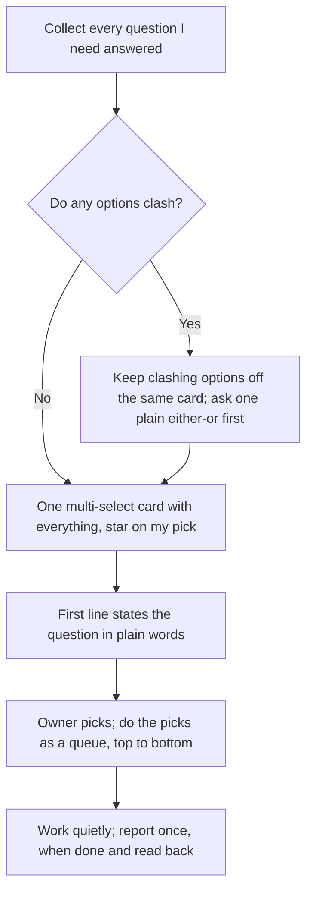

# Card preflight (core)

Run this every time, before a question or decision card goes to the owner. It exists because one easy choice once took five cards (owner, Nov 17, 2026: "This shouldn't have been as hard as it was."). It extends `decision-cards` and the card rule in `tcs-message-format-structure`; it does not replace them.

## Steps
1. **Collect everything first.** Write down every question you need answered this turn before you send anything. Never send a second card for a question you already knew about.
2. **Check for clashes.** Two options clash when doing one rules out the other (for example "keep it as a picture" and "replace it with a link"). Options that can both be done do not clash.
3. **Choose the card type.**
   - Nothing clashes: send ONE multi-select card with every option and question on it.
   - Some options clash: keep them off the same multi-select card. Ask one plain either-or card for the clashing pair first, then put everything else on one multi-select card. If they arrive together anyway, do the non-clashing picks and settle the clash with one either-or card.
   - Never turn a question that has no clash into an either-or.
4. **Write the first line plainly.** The owner may hear only the start of a message, so put the question first in simple words. Name things by what they do, not by IDs, skill names or numbers. Put detail after the question.
5. **Format the options.** Put ★ on the one option you recommend (never the word "Recommended"). Each option states the action first and ends with the owner's authorization line. List options in priority order. A next-step card ends with the pause option.
6. **Read it back once.** Before sending, check: Could two of these options both be picked when only one can happen? Is any question left that needs its own card? Does the first line make sense on its own? Fix it, then send.
7. **After the pick.** Do the picks as a queue, top to bottom. Work quietly and report once, when the work is done and read back. Don't send a status line for every step.

## Algorithm

## Origin (owner, first-hand, Nov 17, 2026 AST)
- 9:34 PM: "If things conflict, isolate them." / "Always." / "Binaries to disambiguate first."
- 9:35 PM: "Speak clearly to me. I am your user." / "Imagine that I am only listening to your beginning."
- 9:37 PM: "If your requests do not compete, ask them with multi select."
- 9:38 PM: "We wasted steps." / "Optimize." / "I approve that you come up with and create a core skill."

## Version
v1.0.0 (2026-11-17).

## Changelog
- v1.0.0, 2026-11-17: created at the owner's request after a five-card exchange that should have taken two. Written by Ross (Reformer).
