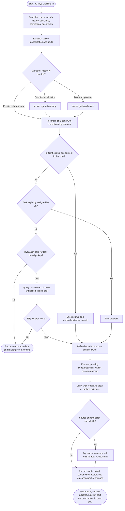

# Clocking In
tier: 2

**Source:** Drive CORE — clocking-in (hub Skill Packages, CORE dated 2026-10-15). Local copy dated 2026-10-16. Prefer the Drive CORE on conflict; refresh this copy when the hub updates. Provider-specific adapters named in the CORE are optional; resolve real capabilities at runtime and report gaps rather than assuming them.

**Hub:** [private reference removed; refer to the private Hub source copy]
**Folder:** [private reference removed; refer to the private Hub source copy]
**Resource bundle (references/scripts):** [private reference removed; refer to the private Hub source copy]

Start or re-enter productive work in **the current conversation**, regardless of its age. Recover the actual work position, then make verifiable progress. This is a user-invoked work mode, not a scheduled task, universal startup command, or permission to replace an existing assignment.

## 1. Classify the entry and recover context

1. Read the accessible history of this conversation, including relevant early decisions, corrections, incomplete tasks, source links, actions and receipts. Do not assume an old conversation is empty, or claim unseen history was read.

2. Establish the active agent manifestation and operational limits from runtime context and current identity/operating owners when material. Preserve provider, model, product/mode, persona, seat, badge and responsibility as distinct fields.

3. **Delegate startup versus recovery** rather than implementing either again:

   - For genuine session initialization or first provisioning, invoke `agent-bootstrap` where installed.

   - For an already-active agent whose Thread / Phase / Task / Step is missing, invoke `getting-dressed` where installed.

   - If identity is established and the work position is already clear, skip both and continue.

4. Reconcile historical chat state with current decisions and the source that owns each consequential claim. Use `company-knowledge-routing` only when ownership or destination is unclear, and `connective-tissue-safe-handling` when status or provenance could be confused. A continuity packet is a retrieval aid, not live execution authority.

5. If the user already named a current priority, project, workstream or task, preserve it. Do not select an unrelated assignment just because it is marked urgent elsewhere.

## 2. Select one eligible unit of work

Follow this order:

1. **Resume an existing eligible in-flight assignment** in this chat. Check its current status, dependency and implementation state before acting; do not redo completed or superseded work.

2. **Otherwise, follow any task explicitly assigned by the user.** A valid non-issue task stays a non-issue task; do not manufacture an issue to satisfy a quota.

3. **Only when this invocation actually calls for task-board pickup**, query the current task owner and choose one suitable, unblocked task under its active rules. Confirm status, dependencies, scope, responsible agent, recent discussion and source/runtime evidence first. Use the task system's configuration rather than assuming Linear exists everywhere.

Use the active task system's defined eligibility, status and priority mapping. A high-priority task is not necessarily actionable; verify dependencies and scope.

If there is no eligible issue or task, report the search boundary and specific reason without creating duplicates, changing statuses to make work appear available, or inventing progress. Proceed with other already-authorized in-scope work only if it really exists; otherwise stop truthfully.

## 3. Execute work and verify

1. Define a bounded outcome for the selected task and identify its current live owner. Keep user-controlled design/canon/approval decisions reserved to the user.

2. For substantial work, compose with `in-session-phasing`: announce the first meaningful phase, execute tool-backed steps, and show compact results at real checkpoints. Skip ceremony for simple tasks.

3. Use the proper connected capability or runtime; take concrete authorized steps instead of stopping at analysis, preparation or a status report.

4. Check outcomes with source readback, tests, build/runtime evidence or another appropriate verification. Separate **performed**, **verified**, **blocked**, **not attempted**, and **proposed** work.

5. Record significant results and actionable continuation in the existing issue/task owner when appropriate and authorized. Compose `auditable-actions-tracing-and-logging` after consequential persistent changes; do not create a second tracking system by default.

6. If a source, connector or permission is unavailable, try a narrow supported recovery; never pretend it was read or written. Ask only for a genuine user-controlled decision or necessary authorization.

## 4. End the activation, not the conversation

Report the one task/workstream pursued, its verified outcomes and evidence, the current remaining work or blocker, and the next executable step. Stop only for completion, a real blocker/gate, a user redirection, or exhaustion of authorized executable work.

**Lifecycle boundary:** Clocking In owns session re-entry and productive execution. It does **not** autonomously create a continuity packet, claim the chat is safe to delete, invoke `ending-session`, or implement the companion `clocking-out` closeout workflow. If the user separately invokes Clocking Out or an explicit close request, hand that request to the session-close owner.

## Portability and specialist boundaries

The CORE above is independent of any provider, Linear, Notion, Slack, GitHub, artifact store, or any particular agent identity. Resolve available provider capabilities at runtime. If a named specialist is unavailable, use only a supported equivalent and report the gap; **naming a skill is not proof of invoking it**. Do not assume cross-seat or cross-provider data access.

- **Provider/task-board specifics** (e.g. TCS Linear mapping) belong in a provider adapter; consult it when available.

- **Behavioral checks:** read [references/acceptance-cases.md](references/acceptance-cases.md) when testing or revising the skill, not for every routine activation.

- **Authorship and source links:** see [references/provenance.md](references/provenance.md) when provenance matters.

## Version
v1.0.0 (2026-10-26). Versioning baseline set by Reformer boy (A2).

## Changelog
- v1.0.0, 2026-10-26: baseline version. No content change.

## Algorithm

