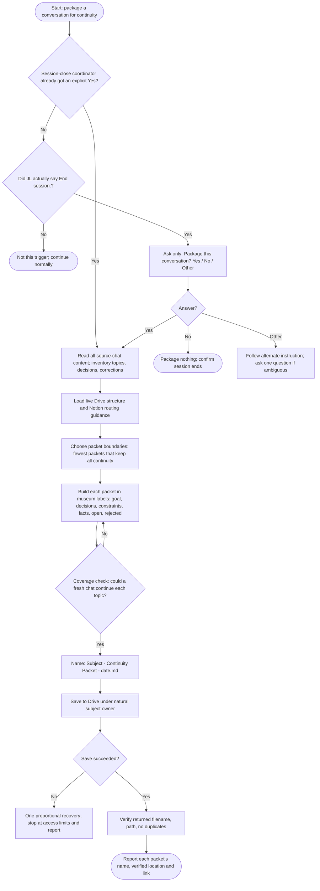

# Conversation Continuity Packaging
tier: 2

**Source:** Drive CORE — conversation-continuity-packaging (hub Skill Packages). Local copy dated 2026-10-16 (synced from the 2026-10-13 CORE, runtime changes through 2026-10-08), plus authorized 2026-10-23 museum+labels add (JL via GitHub boy). Prefer the Drive CORE on conflict for unchanged sections; keep museum+labels until CORE absorbs it.

**Hub:** [private reference removed; refer to the private Hub source copy]
**Folder:** [private reference removed; refer to the private Hub source copy]

Convert the useful state of a conversation into the smallest useful set of durable Markdown continuity packets. Preserve enough context for future retrieval and continuation without carrying the entire chat forward.

## Session-close confirmation gate (standalone fallback)

When `ending-session` or an equivalent authorized session-close coordinator has already collected an explicit Yes to packaging, proceed directly without asking again. When invoked independently and the user says exactly **`End session.`**, treat it as a request to close the session, **not** as permission to package yet.

This Skill is the packaging specialist, not the general session-close orchestrator. Keep explicit packaging instructions actionable; route whole-session closeout decisions to the session-close coordinator when one is present.

1. Ask only: **Package this conversation for continuity using the conversation-continuity-packaging skill?** Yes / No / Other
2. Stop and wait. No context recovery, source reads, connector calls, drafting, writes, or verification before the reply.
3. **Yes** → run the full workflow below. **No** → package nothing; briefly confirm the session ends without a package. **Other** → follow the alternate instruction; if still ambiguous, ask one minimal follow-up.
4. Nearby wording ("we're done here", casual talk about ending) is not this trigger unless the user actually says **`End session.`**

## Seat orientation (Grok Bot adaptation)

Portable across Grok Bots; do not assume a particular persona or seat is the invoker. Continuity stores are **seat/context scoped** unless current evidence proves broader access. Resolve the active seat/persona only when identity, authorship, visibility, connector access, permissions, or attribution materially affects packaging or delivery; otherwise stay identity-neutral. Preserve established AI Agent identities, source provenance, and actual permissions; do not invent access parity between seats or providers.

## Choose delivery (Grok Bot adaptation)

Save durable Markdown packets to the invoking bot's configured durable artifact store:

1. **Primary:** Google Drive (Drive connector) under the natural subject owner.
2. **Working copy:** a box path under `/workspace/` when useful.

If the store is unavailable or a save fails, try only a proportional, supported recovery. Stop at an access restriction; do not repeat an unchanged failing attempt. Report which packets were prepared, which were saved, and which remain unsaved. Never imply persistence succeeded or require the user to repeat the request.

## Recover context efficiently

Read all available source-chat content before compressing. Internally inventory substantial topics, secondary threads, user corrections, decisions, meaningful personal or creative context, completed actions, and pending requests — revisiting early and middle portions, not just the end.

Reuse evidence already available. Retrieve attachments or connected sources only where their contents or current state materially affect the packet; batch independent reads and follow relevant names, aliases, and source links. Stop when context is sufficient. Packaging does not require a workspace-wide audit or changes to maintained sources.

Treat summaries as summaries; check original evidence when exact wording, authorship, or completion matters. Distinguish direct user statements, verified actions, assistant reports, and inference. If history is unavailable or truncated, state the coverage gap briefly; never claim exhaustive recovery of unseen content.

## Placement and naming

1. Load current repository/Drive structure before creating, moving, or verifying files.
2. Retrieve current Notion routing guidance when available (e.g. `TCS Conversation Routing Recommendations`, AI Agents operating context). If Notion is inaccessible, do not pretend it was checked; use the best authorized current source and keep the gap explicit when it matters.
3. Follow the user's newest applicable instruction, the live structure, and maintained guidance. Treat older fixed packet paths as historical when they conflict.
4. Route each packet to its natural subject owner (e.g. Personal, AI Collaboration, TCS / Record Label Simulator, RAW VOW, Research & Analysis). Use an artifact-type subfolder only when it improves retrieval. If ownership is unclear, use the current temporary intake/quarantine location.
5. Do not create or restore one universal `Conversation Continuity Packets` folder as the default destination.
6. Name narrow → broad: `[Narrow Packet Subject] - Continuity Packet - YYYY-MM-DD.md`

## Choose packet boundaries

1. Identify whether the chat has one or several substantial continuity-worthy topics.
2. Separate packets when topics are meaningfully easier to retrieve or continue independently.
3. Merge topics that form one coherent future-use context or depend on the same decisions.
4. Use the smallest number of packets that preserves all important continuity; protect useful secondary topics without splitting minor tangents.
5. Keep only the overlap needed for each packet to stand on its own.

## Museum + labels (JL 2026-10-23)

JL authorized labeled archives ("little museums") so trail can be optimized through tags, not one mushy dump. Use conversations plus notes.

When building a continuity packet, scratchpad archive, or trail museum, structure substance under labeled sections (omit empty ones):

- **goal** — what this thread was trying to achieve
- **decisions** — settled choices and approvals (quote JL when precision matters)
- **constraints** — hard limits, holds, and must-nots still in force
- **facts** — verified state, links, badge strings, dates, artifact paths
- **open** — unresolved asks, blockers, next continuation point
- **rejected** — discarded paths kept only so they do not return

Tags/schema may also appear as short frontmatter or heading labels for retrieval. Do not dump chronological mush; rehash into these compartments.

## Build each packet

Capture the current useful state, not a chronological transcript summary. Prefer the museum labels above. Include only what another chat would need: purpose/objective; conclusions, corrections, decisions, approvals, exact terminology; relationships, mappings, dates, counts, artifact references; completed work that changes next steps; unresolved work, blockers, dependencies, next continuation point; current controlling sources.

State that the source chat may contain stale or superseded context; direct future use to compare against newer chats, newer user instructions, current Memory when available, and maintained sources. Do not imply a packet or external store is itself persistent Memory.

Include the source chat title/link and date range when available, plus preparation date; keep event dates separate from capture dates. Add only useful aliases or exact links; never invent metadata. Include needed substance rather than relying on links that may become inaccessible.

Preserve uncertainty as uncertainty. Exclude rejected assumptions, mistakes, outdated interpretations, dead branches, banter, repetition, and superseded conclusions unless a short **rejected** note prevents their return. Preserve the user's corrected proposition as current fact.

## Check coverage and compression

Compare the draft against the topic inventory: every relevant thread represented with meaning, relationships, and necessary reasoning intact. Exhaustiveness means coverage of relevant context, not every sentence. Consolidate repetition before shortening unique information; use the smallest sufficient length, not an arbitrary cap.

Ask whether a fresh chat could continue each topic without the user reconstructing it. Keep useful personal, creative, and historical context even without a next action. Omit empty sections and invented blockers; a detail never specified is not automatically an open decision. Check terminology, corrections, completed-vs-pending status, provenance, and cross-packet duplication. Exclude hidden reasoning and low-level tool narration.

## Save and verify

1. Create each packet as a Markdown file.
2. Save each under its current subject owner in the configured store.
3. Verify the returned filename and path for every file.
4. Check this task's returned file identities for unintended duplicates or misplaced root items (local working bytes are not an extra copy). No global duplicate scan for a bounded task.
5. Preserve existing file identity when updating an existing packet; create a new file only when none exists or the user asks for a separate copy.
6. Never claim another seat or external AI can retrieve the packet unless that access was actually established.

## Report the result

Return each packet's filename, verified location, and a verified opening link. Never invent links or file citations. When multiple packets were needed, briefly explain the split/merge; for one topic, report the single packet.

## Skill drift

If real use exposes stale seat, store, Memory, persona, access, routing, or source assumptions: flag the exact drift in the maintained TCS Skill-maintenance surface; tell the user what needs maintenance and why; do not silently rewrite without authorization; after authorization update via UpdateSkill, validate, and verify against the case that exposed the drift.

## Version
v1.0.0 (2026-10-26). Versioning baseline set by Reformer boy (A2).

## Changelog
- v1.0.0, 2026-10-26: baseline version. No content change.

## Algorithm

