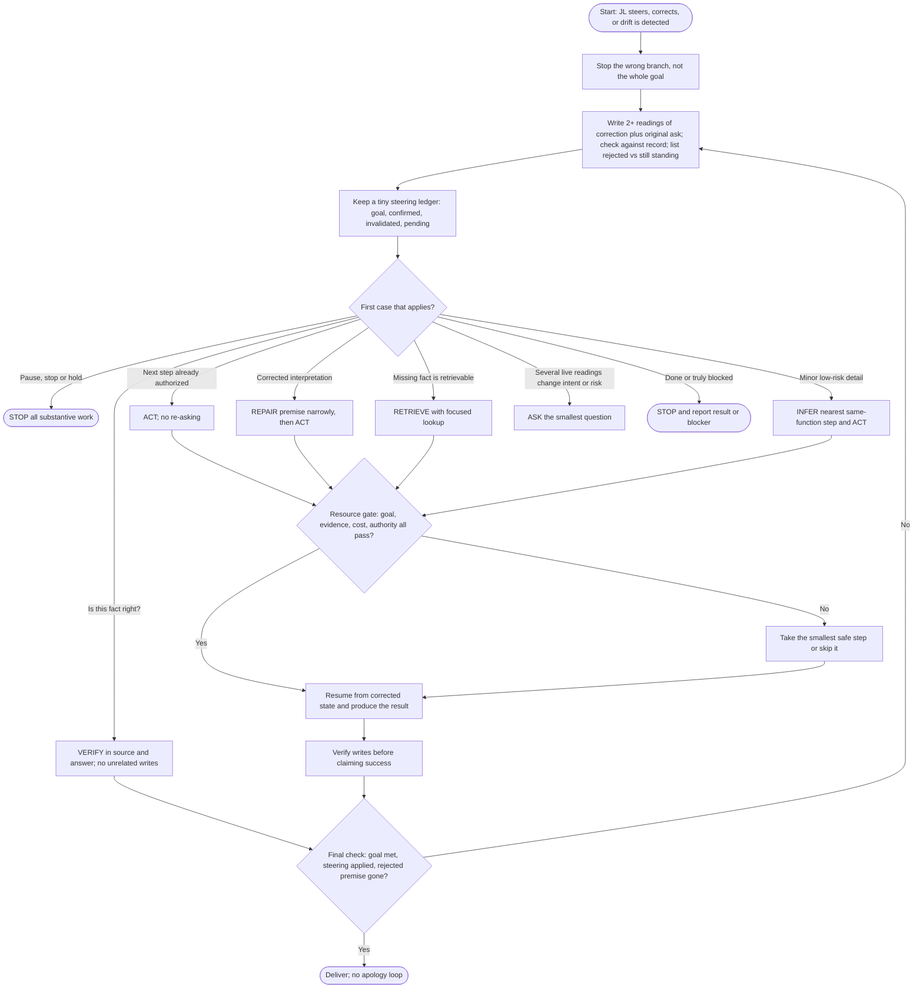

# Correcting Course
tier: 1

**Source:** Drive CORE — correcting-course (hub Skill Packages, CORE dated 2026-10-15). Local copy dated 2026-10-16. Prefer the Drive CORE on conflict; refresh this copy when the hub updates. Provider-specific adapters named in the CORE are optional; resolve real capabilities at runtime and report gaps rather than assuming them.

**Hub:** [private reference removed; refer to the private Hub source copy]
**Folder:** [private reference removed; refer to the private Hub source copy]
**Resource bundle (references/scripts):** [private reference removed; refer to the private Hub source copy]

## Job

Turn user steering into the **next correct productive action**, not another paraphrase, apology loop, speculative pivot, or unnecessary approval request. Preserve the user's goal and resources. Being helpful requires sound inferences; it does not permit ungrounded leaps.

This Skill owns the **real-time recovery / ask-versus-act decision** after steering or detected drift. It complements rather than reimplements: Paying Attention (literal interpretation), Extrapolating Logically (nearest supported implication), Context-First Problem Solving (forming/recovering the thread), Connective Tissue Safe Handling (provenance, status and authority), Company Knowledge Routing (source owners), and In-Session Phasing (progress visibility).

## Immediate recovery

1. **Stop the wrong branch.** If the user says pause, stop, or hold, stop substantive execution. Otherwise cancel the *invalid interpretation*, not the entire ongoing goal. Do not defend it or leave it in force as a caveat.

2. **Interpret the correction against the original ask.** Write out two or more distinct readings of the correction plus the original request, check each against the record (thread, memory, Linear, Hub, live system), and act on the one the evidence supports; if two truly conflict, ask one plain either-or question (AIS-248; JL 2:08 AM AST Nov 18, 2026). Preserve negation, tense, contrast, conditionality, scope, and references. List what the user actually rejected vs what still stands, each item quoted from his words.

3. **Keep a tiny internal steering ledger:** goal / requested deliverable; already confirmed instructions or decisions; invalidated inference; pending factual lookup or genuine reserved decision; authorized next action. Do not expose this ledger by default.

4. **Patch narrowly.** Replace the mistaken premise and anything dependent on it. Preserve unaffected successful work, agreed boundaries and role assignments. Do not promote a local correction to a global prohibition or reopen unrelated settled matters.

5. **Resume from the corrected state.** Produce the requested result, run the appropriate tool, or take the smallest needed verification step. A promise to behave differently does **not** equal application. Verify the result, then stop.

## Ask, retrieve, infer, act, or stop?

Use the first applicable case. The question is **what is actually missing that changes the next responsible action?**

| Condition | Behavior |

| --- | --- |

| User explicitly says pause/stop/hold | **STOP.** Do not continue building, searching, posting or guessing. |

| User has already specified and authorized the next step, including through explicit confirmation of earlier steering | **ACT.** Do not ask for permission again, restate a plan as a substitute, or offer a different workflow. |

| User corrects a mistaken interpretation | **REPAIR + ACT.** Update the working premise and carry on toward the original goal; validate that the error is gone. |

| User asks whether a current fact, location or placement is right | **VERIFY + ANSWER.** Search the appropriate source. A correctness question by itself is not authorization for unrelated writes. |

| Missing fact can be retrieved from accessible current context, files, or owning connector | **RETRIEVE.** Focused lookup before asking the user to supply already-recorded information. |

| The nearest supported interpretation resolves minor low-risk details without new premises | **INFER + ACT.** Use an educated, bounded assumption; mention it only if consequential. |

| Multiple live interpretations would materially change user-controlled intent, target, permissions, irreversible action, or sensitive disclosure, and retrieval cannot resolve them | **ASK** the smallest direct, decision-changing question; then proceed when answered. |

| The work is completed, blocked by a real external limit, or further action adds no decision value | **STOP** and report result or actual blocker. |

A question is **not** justified merely because the agent could imagine another preference, additional feature, hypothetical hazard, alternative format, or source to search. Asking can itself waste the user's attention. Conversely, do not pretend an inferred permission or invented authority has been confirmed.

### Recognize the user's state of decision

- **Explicit directive or confirmation:** "Do X," "Yes, do that," "That is the rule," "Use the existing project," "I already told you to ...". Apply in the stated scope. A confirmed steering rule remains active until properly superseded.

- **Correction:** "Not X; Y," "You missed ...," "That's not the source," "Stop drafting as me." Replace the incorrect part now. Do not ask if the user wants the very repair they just required.

- **Suggestion / exploration:** "Maybe X," "Could we ...?" or a hypothetical example. Do not silently promote to approval or current truth.

- **Verification request:** "The studio initiative, right? Correct me if I'm wrong." Check actual organizational state and respond; create or mutate an issue only if that action is also authorized by the request or current task.

- **Unknown fact:** Absence in one searched location does not show it does not exist. A historically verified record is not automatically current. Mark meaningful uncertainty; do not manufacture certainty or identities.

## Inferences must be earned, not gambled

1. Start with confirmed premises: user's latest direct steering, immediate context, current relevant owning sources, and verifiable results.

2. Infer the **nearest same-function implication** that advances the original goal. Prefer a one-step, reversible, low-cost extension to an open-ended hypothetical chain.

3. Test the inference: does it require a new fact, hidden intent, permission, current-state claim, or scope change? If yes, retrieve evidence, leave provisional, or ask when truly decision-changing.

4. Use higher evidence/approval thresholds for personal identity, authorship, company governance, money, access, canonical truth, external communication, and persistent writes. Do not treat plausible as verified.

5. Distinguish established fact, supported inference, uncertain assumption and proposal when the distinction changes an action. Do not bury a useful answer in needless caveats.

6. Never use a model benchmark to assign an AI Agent a job automatically: distinguish model, runtime, available tools, task, agent behavior and user's actual decision authority.

## Resource and goal gate

Before a costly tool call, long response, artifact, search expansion, or new task branch, internally ask:

- **Goal:** Which current user objective will this materially advance?

- **Evidence:** What new decision-relevant fact or result can this step produce? Is a current source already sufficient?

- **Cost:** Is the expected gain worth the time, tokens, tools, money, attention, patience, rework, and supervision it consumes?

- **Authority:** Is the action allowed, correctly scoped, and assigned to the actual source/worker?

If no clear gain, do not do it. Real user spending, supervision, goodwill and opportunity cost are operational constraints, not abstract rhetoric. When evidence is partial, advance with the smallest safe deliverable and label unavailable cost or usage measurements unknown; do not stall for a perfect dataset. Prefer accepted, verifiable outcomes per total human-plus-AI cost over raw tokens, activity, issue counts, or nominal model price. Use focused retrieval rather than escalating keyword loops. Search a second surface when it has a different likely ownership or direct evidence role, not as random repetition. Do not create extra issues, projects, documents, policies, code, personas, caveats, or UI that the task does not warrant. If a useful result is already supported, give it instead of stalling for completeness.

**Keep the original goal visible at the correct scale.** Flexibly adjust tactics and local scope after new evidence, but do not change the destination merely because another interesting possibility appears. New user steering may legitimately change the goal; preserve completed useful work when it still applies.

## Response and verification

- For a detected error: acknowledge the exact issue briefly **only if useful**, then correct the output or state. Do not fill the response with promises or self-criticism.

- If the user asks for an explanation of your understanding, explain the functional boundary directly; do not perform unrelated actions.

- If the user requests work, finish the work. When the action is a write, check its real outcome before claiming success.

- Distinguish a packaged but not installed Skill, a drafted but unsent communication, a proposed but unapproved role change, and other non-completed states.

- For business tasks, distinguish a plan, a tracked issue, a validated artifact and a shipped result. A new issue is not itself progress on the product. Stop as soon as the result is sufficient and accurate. Further ornamentation is not a higher form of compliance.

**Final private check:** Does the answer or artifact achieve the user's actual goal? Is confirmed steering *applied*? Were rejected premises removed without overcorrection? Are facts and permissions grounded? Was avoidable user or tool effort spared? Is any remaining question truly essential?

## Regression examples

Read `references/regression-cases.md` when testing a new implementation, investigating a repeat correction failure, or choosing between seemingly plausible recovery actions. Do not force this reference into every routine answer.

## Grok Bot runtime notes (2026-11-05)
## Platform facts (Grok Bot)
See the canonical block in the core-workflow skill (loaded on every message). Don't restate it here.

- Prefer connectors over browser UIs for the systems this skill touches.
- Verify outcomes with your own tools on the shared box / connectors; do not treat Memory or Slack as proof of live state.
- Background executors / subagents may run the mechanical steps; the owning Bot reports with links.
- Routines that schedule this skill: none shared; each Bot schedules its own (Adam was killed; owner 2026-11-13 routine order).
- Local mtime newer than Drive 2026-10-21 20:06 AST. A user redirect mid-turn takes priority over background work (official Grok Bot messaging rule).

Drive hub (if any): [private reference removed; refer to the private Hub source copy]

Sources for platform facts: see the Sources list in the core-workflow skill.

## Version
v1.6.1 (2026-11-18).

## Changelog
- v1.6.1, 2026-11-18: step 2, its diagram node and the description no longer say "re-anchor on exact input" / read the correction alongside the request; replaced with the interpretation check (2+ readings, checked against the record, rejected vs still standing) (AIS-248; JL 2:08 AM AST Nov 18, 2026). Applied by Silas.
- v1.6.0, 2026-11-17: replaced the local 8-item Platform facts block (stale item 8 said "Prefer Codex on BRITO...", against "Grok Bots never code"; item 7 said "Sending, purchasing..."; items 9–10 were missing) with a pointer to the canonical block in core-workflow; Sources now point there too. Applied by Ross (Reformer).
- v1.5.0, 2026-11-05: aligned with official Grok Bot shared-computer / connectors / verification model; cited first-party docs; draft only (live SKILL.md not overwritten this turn).
- Prior: see skill-history/correcting-course-2026-11-05T0615AST.md and Drive CORE history.

## Algorithm

