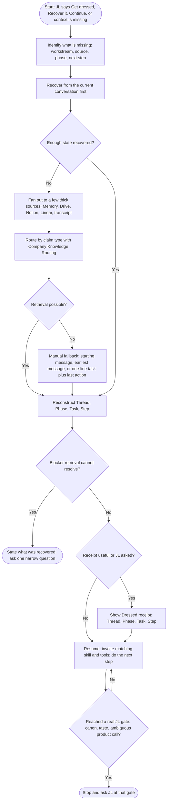

# Getting dressed
tier: 2

**Source:** Drive CORE — getting-dressed (hub Skill Packages). Local copy dated 2026-10-06. Prefer the Drive CORE on conflict; refresh this copy when the hub updates.

**Hub:** [private reference removed; refer to the private Hub source copy]
**Folder:** [private reference removed; refer to the private Hub source copy]

## Core rule

Treat **Get dressed** as an operational recovery trigger.

Do not answer by merely saying context is missing, reciting a protocol, or asking JL to repeat information that can be retrieved. Retrieve the missing context first, restore the working position, and resume the actual work.

Metaphor: missing context = the clothes do not exist; unretrieved context = the clothes are in the closet and the assistant came downstairs naked anyway.

## Recovery workflow

1. **Identify what is missing.** Workstream, governing source, current phase, objective, next step, recent decision, artifact, execution state, or implementation reality.
2. **Recover immediate continuity first.** Use the current conversation before external retrieval. If the relevant state is not sufficiently present, retrieve from appropriate personal or company sources.
3. **Fan out when one source is too thin.** Open a small fan of thick, relevant pages/files. While reading ask: What currently controls this? What changed most recently? What was JL trying to accomplish? Where did the work actually stop? What is established, inferred, stale, or unresolved? What can be executed now without another approval? Answer from retrieved evidence before proceeding.
4. **Route by claim type.** For TCS/company work, compose with **Company knowledge routing** and **Connective tissue safe handling** when source ownership matters. Do not search every system mechanically; use the smallest set that can restore the needed state.
5. **Reconstruct the working position** (internal):
   - **Thread** — the active workstream or subject.
   - **Phase** — the bounded stage the work is currently in.
   - **Task** — the concrete objective being accomplished now.
   - **Step** — the next executable move.

   Surface them only when doing so improves supervision, resolves ambiguity, or JL explicitly asks. Otherwise use them as the internal recovery frame and keep moving.
6. **Resume, do not stop at recovery.** Invoke any task-specific skill that now matches, call the relevant tools/connectors, and perform the next authorized action. A successful recovery should normally end in forward progress, not a context summary.
7. **Take command within the authorized scope.** Exercise delegated judgment through ordinary reversible decisions. Continue until a genuine JL-controlled gate: creative canon approval, taste, a materially ambiguous product decision, permission boundary, or consequential irreversible action.
8. **Ask one small question only if retrieval cannot resolve the blocker.** State what was recovered and ask the narrowest question that changes the next action. Do not fabricate missing state.

## Grok Bot retrieval map

ChatGPT Memory / Custom GPT / Actions map here as:

- **UpdateMemory / RecallMemory** — durable personal and agent facts.
- **UpdateSkill / Read workflows** — installed skill recipes under `[private reference removed; refer to the private Hub source copy]`.
- **Drive MCP** — durable product knowledge and CORE packages.
- **Notion MCP** — governance, decisions, incident register, operating context.
- **Linear MCP** — current execution state (issues stay assigned to JL).
- **Slack / Gmail MCPs** — coordination and mail evidence when those surfaces own the claim.
- **Supabase / GitHub / Origin / CloudAgent** — live data and implementation reality when those own the claim.
- **ReadTranscript** — this chat's prior turns when continuity is in-session.

## Manual fallback chain

When JL is manually seeding recovery or source retrieval is unavailable:

1. Prefer the exact message where the current work began.
2. If missing, use the earliest surviving message that shows what the work was trying to do.
3. If no message survives, use a one-sentence task statement plus the last remembered completed action.
4. If JL says **"Recover it"**, reconstruct from context and sources available to you.

Do not require JL to paste a message when reliable retrieval can recover the same state.

## Continuation semantics

- **"Continue" after a detour** — recover the substantive topic from before the detour and resume its actual state.
- **"Get dressed"** — retrieve context now, not explain how retrieval would work.
- **"Recover it"** — reconstruct the workstream without making JL restate it.
- **"Take command"** — choose and execute the next authorized move, coordinate tools and sources, verify, continue until a real human gate.

## TCS execution bias

When the recovered work is TCS / Record Label Simulator / Gaia / The Studio, prefer actions that materially move the product forward over status-only narration: move the boundary forward; complete one CEO decision loop; make Gaia move or become more observable; close a spec-to-code gap; verify implementation reality; take an issue to done; ship JL something he can touch; write a useful handoff only when it enables the next operator; keep going until a genuine JL decision gate.

## Failure modes to avoid

- Reciting source-routing rules without calling the tools.
- Asking JL to repeat context that is retrievable.
- Treating the current chat as the whole world when prior context is clearly required.
- Searching one isolated keyword and stopping when adjacent sources are needed.
- Reading many sources but failing to answer the recovery questions.
- Producing a polished status report instead of resuming the task.
- Treating older continuity or copied material as current authority without checking the owning source.
- Claiming implementation from plans, specs, screenshots, or prose without runtime/repository evidence when implementation reality matters.
- Returning control to JL for ordinary agent-level decisions that can be safely resolved from current authority.

## Compact supervision pattern

When JL benefits from an explicit recovery receipt:

```text
Dressed.
Thread: [workstream]
Phase: [current stage]
Task: [current objective]
Step: [next move]
```

Then execute the step. Do not let the receipt become the deliverable unless JL asked for it.

## Skill drift

Flag Notion when authorized; tell JL; UpdateSkill after authorization. Drive CORE remains canonical.

## Version
v1.0.0 (2026-10-26). Versioning baseline set by Reformer boy (A2).

## Changelog
- v1.0.0, 2026-10-26: baseline version. No content change.

## Algorithm


