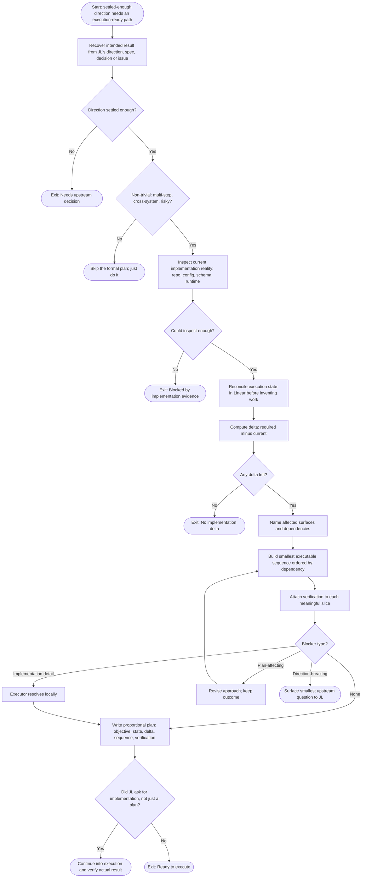

# Implementation planning
tier: 2

**Source:** Drive CORE — implementation-planning (hub Skill Packages). Local copy dated 2026-10-06. Prefer the Drive CORE on conflict; refresh this copy when the hub updates.

**Hub:** [private reference removed; refer to the private Hub source copy]
**Folder:** [private reference removed; refer to the private Hub source copy]

Turn settled-enough direction into an execution-ready path without reopening decisions that have already been made or inventing work that already exists.

## Core role

Answer: **Given the intended result and the actual current state, what is the smallest complete path to implement and verify the remaining change?**

Useful lifecycle (not mandatory ceremony):

**context and calibration → development → proposal drafting when needed → implementation planning → execution → verification**

A formal proposal is not required when the intended direction is already sufficiently established by JL, a controlling specification, an approved decision, or another authoritative source.

## Core invariants

### Plan from reality, not from the brief alone

Before prescribing implementation, inspect the current implementation and relevant execution state when available.

- Distinguish intended design from what is actually implemented.
- Identify work that already exists, is partially implemented, is already tracked, or is already complete.
- Plan only the remaining implementation delta.
- A historical handoff, old plan, continuity packet, or proposal is context; it is not proof of current implementation or current task state.

### Tight goals, adaptable plans

Keep stable unless authority changes them: intended outcome; material scope and exclusions; controlling constraints; acceptance conditions; reserved decision gates.

Let lower-level implementation details adapt when current evidence changes the efficient route. Do not freeze tool order, search order, batching, decomposition, or incidental file sequence unless that order is materially required.

### Do not re-propose settled direction

Operationalize a sufficiently settled change. Do not reopen product, design, policy, canon, naming, or architectural decisions merely because planning makes them more concrete. If new implementation evidence materially invalidates the settled direction, surface the exact conflict and the smallest decision that must move upstream. Do not silently substitute a different direction because it appears easier.

### Planning is not implementation

A plan describes the path; it does not establish that the change occurred. When JL requested implementation rather than planning as the final deliverable, treat the plan as intermediate and continue into execution when context, authorization, and tools permit. Do not stop at a plan merely because this skill was invoked.

## Workflow

1. **Recover the intended result.** What must become true when implementation is complete. Use JL's current direction and the relevant settled proposal, specification, decision, brief, issue, or acceptance conditions. Preserve explicit exclusions and reserved human decisions.
2. **Determine whether planning is actually needed.** Material plan for multi-step, cross-system, structural, migration, architectural, risky, or otherwise non-trivial work. For a tiny, obvious, already-authorized change, keep the plan implicit. If direction is materially unresolved, do not fabricate an implementation choice — surface it or return upstream.
3. **Inspect current implementation reality.** Read the actual surface that owns the behavior: repository/code (Origin / GitHub MCP / CloudAgent), configuration, schema, database (Supabase MCP), current skill (`[private reference removed; refer to the private Hub source copy]`), connected system, runtime, generated artifact. Use current evidence rather than remembered structure.
4. **Reconcile current execution state.** When relevant, inspect Linear (Linear MCP) before inventing new work items. Linear normally owns current representable execution state for TCS. Do not create duplicate issues for plan bullets. Create or update execution records only when authorized; otherwise describe the mapping in the plan. Assignee stays JL — never assign a Grok Bot.
5. **Compute the implementation delta.** Compare current vs required state. Separate already-correct behavior from remaining work.
6. **Identify affected surfaces and dependencies.** Name concrete systems, modules, files, schemas, prompts, skills, configurations, interfaces, tests, artifacts, or connected records. Search for references before structural changes. Distinguish hard dependencies from convenient sequencing.
7. **Build the smallest executable sequence.** Order by dependency and verification. Keep steps actionable. Combine repetitive low-level edits. Preserve safe parallel work when write ownership allows.
8. **Attach verification to meaningful slices.** Focused tests, typecheck, lint, build, schema validation, query/readback, runtime observation, render inspection, reference search, or acceptance review as appropriate. A passing check proves only what it tests.
9. **Classify blockers.** *Implementation detail* — executor resolves locally. *Plan-affecting discovery* — revise approach, preserve outcome. *Direction-breaking discovery* — surface smallest upstream decision. Do not escalate ordinary details into unnecessary JL gates.
10. **Produce the execution-ready plan.** Proportional. If no implementation work remains, say so.

## Source and system roles (Grok Bot surfaces)

Choose sources by what they own. When ownership is unclear, compose with **Company knowledge routing** / **Connective tissue safe handling** rather than embedding a competing routing doctrine here.

- **JL's current direction / approved decision:** intended outcome, scope, priorities, reserved decisions.
- **Google Drive (Drive MCP):** durable product knowledge, design, specs, canon, research.
- **Notion (Notion MCP):** governance, approvals, decisions, source-routing context, coordination/provenance.
- **Linear (Linear MCP):** current representable execution state.
- **GitHub / Origin / CloudAgent / repository / runtime:** implementation-current code, config, tests, builds, observed behavior.
- **Supabase or another live structured system:** current data/schema when that system is being changed.
- **UpdateMemory / RecallMemory:** durable personal/agent facts — not a substitute for Drive/Notion canon.
- **Current official external sources:** provider behavior, APIs, standards, externally controlled constraints.

Do not lower source authority because another source is easier to access.

## Boundaries

- **Proposal drafting** answers *what change are we proposing?* This skill answers *how will we implement and verify the remaining change?*
- **Work preparing** establishes enough to begin cleanly (PRE). Go deeper here only when a concrete technical/operational path is needed.
- **Execution tracking:** a plan may map onto existing issues; it is not itself the tracker. Reconcile before proposing new ones.
- **Execution and action tracing:** do not claim planned work is implemented. After execution, verification describes actual resulting state, including meaningful deviations.

## Default plan format

Use the smallest subset that helps. Do not force every heading.

```markdown
## Implementation Plan

### Objective
[What must become true when implementation is complete.]

### Current state
[Only implementation and execution state that materially affects the plan.]

### Remaining delta
[What still needs to change; exclude work already complete.]

### Affected surfaces
[Concrete systems/files/modules/schemas/configuration/issues when useful.]

### Implementation sequence
1. [Executable step and why it precedes later work.]
2. [Next coherent step.]

### Verification
[Checks tied to material slices and final acceptance.]

### Blockers / required decisions
[Only genuine blockers. Omit when none.]

### Execution mapping
[Existing issue/task mapping when relevant. Omit when unnecessary.]

### Completion condition
[What establishes that the intended implementation is actually finished.]
```

## Plan exit states

- **Ready to execute** — current state known enough; remaining path actionable.
- **Ready with adaptive details** — outcome and sequence sound; lower-level choices may adjust.
- **Blocked by implementation evidence** — cannot inspect sufficiently.
- **Needs upstream decision** — material unresolved direction.
- **No implementation delta** — required state already present.

## Quality checks

Intended result settled enough? Plan reflects current reality? Execution state reconciled when available? Existing work not re-created? Steps contribute to remaining delta? Dependencies real? Verification tests changed surfaces? User-controlled decisions remain user-controlled? Plan does not silently authorize execution or claim completion? Plan no larger than required?

## Skill drift

Flag Notion when maintenance is authorized; tell JL what needs maintenance; do not silently rewrite without authorization; after authorization use UpdateSkill, validate, and verify against the case that exposed the drift. Drive CORE remains canonical — refresh this local copy when the hub updates.

## Version
v1.0.0 (2026-10-26). Versioning baseline set by Reformer boy (A2).

## Changelog
- v1.0.0, 2026-10-26: baseline version. No content change.

## Algorithm


