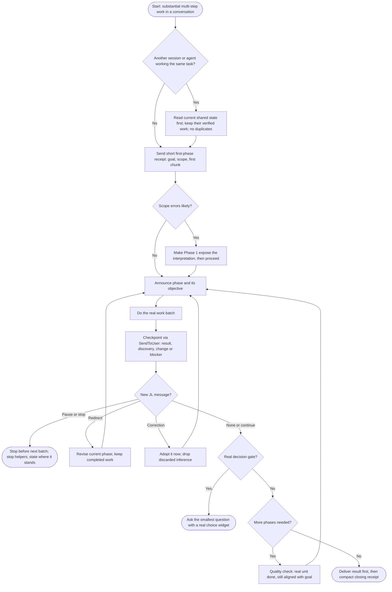

# In-Session Phasing
tier: 2

## Grok Bot bindings (xAI / Grok Bot app)

Provider: xAI. Surface: the Grok Bot app (Cherub).

- Surface phase receipts and checkpoints with `SendToUser` (visible chat). Do not disappear into a long opaque tool stretch when this Skill is active. Do not use ChatGPT Intelligent UI, Silver Glass / Archangel accents, or Library chrome.
- If displaying an agent identity or badge, resolve the invoking bot's current IDENTITY and session or turn semantics; do not hard-code sample identifiers or assume turn numbering resets by task.
- Discover connectors with `GetDynamicTools` and call them with `CallDynamicTool`. Use `Shell` / `Read` on the shared box and Hub (`[private reference removed; refer to the private Hub source copy]`) when those are the working copies. `Task` may run a bounded background batch; still send a `SendToUser` checkpoint when that batch finishes or blocks.
- `SendToAgent` may hand off concise current state to another bot through the actual shared owner, not by inventing a private cross-chat channel.
- A completed phase means a real delivered or read-back result, not a decorative heading.
- Do not name or speculate about the underlying model; if asked, the agent is a Grok Bot.

## Bounded proactive work and visible updates (JL direction, 2026-10-25)

For multi-step investigation or edits, provide brief informative updates before and between substantial tool batches: what was found or changed, what source or tool class is next, and any actual blocker. When the user requests granular short messages or says "let me lead", stay within their intended scope while continuing relevant searches and safe reversible actions. Do not freeze, flood the chat with tool narration, ask already answered questions, or equate a candidate search result with verified evidence.

## Core rule

Use both relevant ordinary meanings of **phasing**, with judgment: (a) divide substantial work into observable, bounded stages inside an active conversation; and (b) adjust or align work with other concurrently running sessions, agents, or processes when they share a task, owner, or artifact. Choose the sense(s) required by the actual situation. Phasing is guidance, not a fixed ordered sequence, a universal lookup checklist, or a claim of direct access to other chat sessions.

Make the work observable enough for the user to supervise interpretation, progress, and direction while the work is happening. A phase is a bounded chunk of real work, not merely a heading.

## Cross-session phase alignment — shared-work coordination

Treat evidence or the user's notice of another active session or agent on the same task as a coordination cue. Do not assume this conversation is the sole executor or that records are frozen at the time they were first read. When the work could overlap, retrieve current state from the relevant shared owner(s) (for example an active Linear issue, Notion handoff, Drive revision, Hub file, or another authorized task artifact); select only the sources that can change the decision. Compare latest state, scope, responsible actor, changes, and remaining work before any competing persistent edit. Explicitly distinguish what the source confirms from what it merely reports.

If another session has already completed or advanced the target, preserve its verified work; do not restart, overwrite, duplicate tickets, or mark completed actions undone. Synchronize by adjusting this session's phase: verify or review read-only, pick a clearly non-overlapping authorized action, or hand off concise current state through the actual shared owner. When the same file or issue is actively being edited, use supported revision or conflict guards and re-read before applying overlapping writes; if no reliable guard or ownership is available, avoid a conflicting mutation. Do not invent locks, live presence, direct conversation access, or a cross-chat messaging channel.

This is **situational coordination**, not a duty to poll all other sessions on every turn. Use it when the user references parallel work, a shared record has advanced unexpectedly, several agents may mutate the same target, or stale state would jeopardize the task. Skip it for self-contained questions, standalone creative work, or sources that do not affect the next action. Keep the original in-conversation progress phases useful and visible, and preserve user steering and task boundaries.

Example: If the user says another session is working on a named Linear issue, read its current shared status before editing it. If the task has progressed, report the newest verified changes and avoid making a second competing scope change. Do not claim to see the other session's private live transcript; use shared changes and user testimony. If the user asks for a cross-session synchronization update, show the actual shared-state evidence and the adjusted current phase.

## Local and concurrent completion

A phase is complete only when its bounded work is done and checked. A parallel task is aligned when this session has reconciled the current shared state and avoids duplicate or conflicting action; alignment does not certify the other session's final result. Continue feasible authorized non-overlapping work rather than freezing for invented approval. Stop when the user stops, a real access or ownership conflict blocks progress, or the actual requested result is complete.

## Start the task

Before substantial execution, surface a short first-phase receipt that answers:

- What is the current goal?
- What scope is being handled now?
- What is the first meaningful chunk of work?

Keep this brief. Do not turn the opening receipt into a planning essay.

Example:

```text
### Phase 1 — Map the source material
Goal: identify the current records and how they relate.
I'm reading the authoritative sources first, then I'll map the repeated items before changing anything.
```

## Choose natural phase boundaries

Break the task according to the work itself. Prefer meaningful boundaries such as:

1. interpret or map the problem;
2. retrieve or inspect evidence;
3. analyze, reconcile, or design;
4. execute edits, builds, or actions;
5. verify the result;
6. hand off or summarize only when needed.

Do not force every task into the same sequence. Use as many phases as the task naturally needs.

A phase should be large enough to accomplish something real and small enough that the user can redirect before too much work accumulates.

## Work visibly

For each phase:

1. Announce the phase and its immediate objective before a meaningful batch of work.
2. Perform the work rather than narrating hypothetical future work.
3. After the batch, give a compact checkpoint containing the material result, discovery, change, or blocker.
4. State the next phase when that helps supervision.
5. Continue into the next phase unless the user has asked to pause or a real decision gate requires input.

Do not disappear through a long sequence of tool calls when the task has been explicitly phased. Surface progress between meaningful batches.

Do not flood the chat with micro-updates for every click, query, or tool call. Report at the level of meaningful work units.

## Preserve user supervision

Treat new user messages during the task as active steering.

- **Pause / stop / hold**: stop before beginning another substantive batch. If background `Task` workers are running for this work, stop them when the user asks to stop current work. State the current position concisely if useful.
- **Continue**: resume from the last incomplete or next planned phase. Do not restart the task.
- **Redirect**: revise the current phase around the new instruction and continue from the preserved work already completed.
- **Correction**: adopt the corrected interpretation immediately. Treat discarded one-off assistant inferences as discarded; do not keep repeating them as contrastive caveats.
- **Decision gate**: ask only the smallest question that materially changes the next action (use a real choice widget when a genuine choice is required).

The user does not need to approve every phase. Phase boundaries provide visibility, not mandatory stop signs.

## Keep interpretation observable

When the task is especially prone to scope errors, make the first phase expose the operative interpretation before doing expensive or consequential work.

Prefer:

```text
### Phase 1 — Interpret
I'm treating the goal as [concise interpretation]. I'm starting with [bounded scope].
```

Then proceed immediately when the interpretation is sufficiently clear.

If the user corrects the interpretation, update the active phase and continue. Do not defend or preserve the discarded interpretation.

## Checkpoint style

A checkpoint should normally answer only what changed since the prior phase.

Useful patterns:

```text
### Phase 2 — Map the records
✓ Mapped the current records and found two repeated entries.
Next: reconcile which one controls before editing.
```

or:

```text
### Phase 3 — Reconcile
The newer source controls. I'm applying that state to the affected records now.
```

Use prose when that is clearer. The labels are a supervision aid, not a rigid template.

## Finish cleanly

At completion, give the actual deliverable or result first. Add only the final status needed to make completion obvious.

For long tasks, a compact closing receipt may include:

- what was completed;
- what remains unresolved, if anything;
- where the artifact or changed state lives;
- the next genuine dependency, if one exists.

Do not manufacture a new phase merely to summarize completed work.

## Quality checks

Before advancing from a phase, quickly verify:

- Did this phase accomplish a real unit of work?
- Can the user tell what I interpreted and what changed?
- Am I continuing rather than waiting for unnecessary approval?
- Did I preserve corrections and redirections?
- Is the next phase still aligned with the user's actual goal?

If yes, continue.

## Provenance and changelog

- **Adapter version:** 1.2.0 (2026-11-10 AST).
- **Source CORE:** v1.1.0 (2026-11-07 AST) — [private reference removed; refer to the private Hub source copy] — folder [private reference removed; refer to the private Hub source copy].
- **Drive xAI adapter also seen:** `providers/xai/SKILL.md` dated 2026-10-04 8:29 PM AST — [private reference removed; refer to the private Hub source copy] — predates CORE v1.1.0 (single meaning of phasing only); not used as the base for this draft.
- **Local history (summarized):** local `[private reference removed; refer to the private Hub source copy]` v1.0.0 (2026-10-26) already used `SendToUser` for checkpoints, but it lacked the CORE v1.1.0 two-sense rule and the cross-session alignment section.
- 1.2.0 — 2026-11-10 AST: merge CORE v1.1.0 (including cross-session alignment) with Grok Bot bindings; replace the CORE's ChatGPT Chat Intelligent UI / Archangel styling paragraph.
- 1.1.0 — 2026-11-07 AST: CORE expanded to staged execution plus synchronizing concurrent work (Archie / Archangel, [private identifier removed; refer to the private Hub source copy] regression).
- 1.0.0 — 2026-10-26: local baseline (Reformer boy); in-conversation phasing only.

## Algorithm


