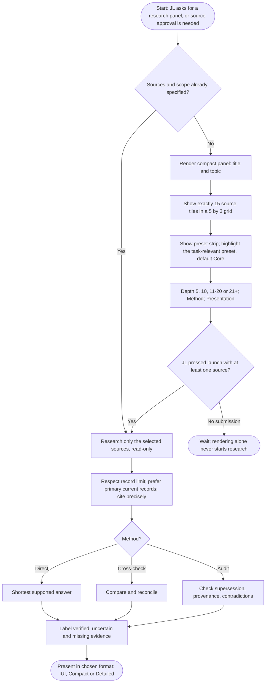

# IUI Research Panel
tier: 3

**Source:** Drive CORE — iui-research-panel (hub Skill Packages, CORE dated 2026-10-15). Local copy dated 2026-10-18 (added the `21+` deep-sweep depth option per JL). Prefer the Drive CORE on conflict EXCEPT for the `21+` depth option, which is a deliberate local extension pending propagation; flag the Drive CORE to match. Refresh this copy when the hub updates. Provider-specific adapters named in the CORE are optional; resolve real capabilities at runtime and report gaps rather than assuming them.

**Hub:** [private reference removed; refer to the private Hub source copy]
**Folder:** [private reference removed; refer to the private Hub source copy]

## Trigger and permissions

- Adaptive behavior: show the interactive panel on request or when user approval of source selection/scope is materially necessary. When sources and scope are already specified, research directly.

- Rendering the panel alone does not initiate research. Launch uses an actual user-triggered submission supported by the host and conveys the current selections; never trigger research merely by rendering.

- Source selection grants read-only research permission, never permission to edit, share, delete, write, or send.

Grok Bot note: **Space** = prior-conversation / Library continuity available to this bot; **Memory** = this bot's personal-context memory. Render with the host's genuine interactive controls (e.g. a question widget or generated UI); if a working 5×3 grid is not supported, use an accessible alternate presentation with the same 15 sources and presets.

## Compact layout

1. Show a short title and task/topic. No large banners, redundant summaries, filler cards, or dropdowns.

2. Show **exactly 15 source tiles in a 5-column x 3-row grid**, in order: Drive, Notion, Space, Memory, Linear, Slack, GitHub, Gmail, Outlook, Web, Supabase, Skills, Data, Consensus, Calendar. These are the ONLY source tiles. Do not add Figma, Canva, or Google Contacts: they are explicitly excluded from this source catalog. Use independent multiselect toggle state, visible selection border and check indicator, compact labels and tappable targets. Preserve 5x3 in phone portrait/landscape and desktop; avoid horizontal overflow.

3. Use authentic service favicons where supported (or truthful text/icon fallbacks): drive.google.com, notion.so, linear.app, slack.com, github.com, mail.google.com, outlook.com. Memory is a brain icon, Web a globe icon, Skills a blocks icon, Data a chart icon; use official favicons for Supabase (supabase.com), Consensus (consensus.app), Calendar (calendar.google.com). Do not pretend generic icons are official logos.

4. Under or adjacent to sources show a **compact, wrapping preset strip** with named one-tap source combinations. Presets are actions, **not additional source tiles**. Each preset replaces the selection atomically with its exact membership. A source tile still toggles independently after any preset. Keep preset labels legible; use small buttons/chips, not full-size cards.

5. Research depth is four adjacent controls `5`, `10`, `11–20`, `21+`, default 10. Selecting `11–20` reveals a slider min 11 max 20 step 1, default 20. Selecting `21+` reveals a deep-sweep slider (or numeric entry) min 21 max 50 step 1, default 30, for exhaustive audits; note compactly that higher depths take longer. This limit is the **total distinct relevant records across selected sources**, not per source.

6. Method and Presentation are **side by side, two equal-width modules**. Method: Direct / Cross-check / Audit; default Cross-check. Presentation: IUI / Compact / Detailed; default IUI. Compact tappable radio-like surfaces, no dropdowns.

7. One prominent launch action at bottom; disabled if nothing selected. Send topic, exact selected source categories, limit, method, format. Do not append a bulky summary.

## Presets (exact source sets)

- **Local** = Space + Memory ONLY. This is the user's specific meaning of Local; **never** interpret Local as files on disk, device storage, container files, or a separate provider. It does not select Drive or Web.

- **Web only** = Web ONLY. Exclude all other research sources.

- **Core** = Drive + Notion + Space + Memory. This is the initial selection default.

- **Canon** = Drive + Notion + Space + Memory; same membership as Core but labeled for continuity/canon tasks. It is acceptable to omit Core from the visible strip when Canon is shown to avoid redundant UI, but maintain Core as a recognized preset.

- **Build** = GitHub + Linear + Drive; for engineering and MVP progress.

- **Comms** = Slack + Gmail + Outlook; for correspondence and handoffs.

- **Workspace** = Drive + Notion + Linear + Slack + GitHub; for operational cross-checks.

- **All** = all fifteen sources.

- **Database** = Supabase + Data + Drive; for data and schema investigations.

- **Research** = Web + Consensus + Data; for evidence synthesis.

- **Planning** = Calendar + Linear + Slack; for deadlines and coordination.

- **Skills audit** = Skills + Space + Memory + Drive; for agent workflow and instruction continuity.

- **Product design** = Drive + Notion + GitHub + Linear; for design-to-build continuity.

- **Full studio** = all fifteen sources (alias of All; avoid displaying both if space constrained).

- **Clear** = none, launch disabled.

## Task-aware recommendations

- Presets are *suggested shortcuts*, not hidden auto-expansions. When a task is known, **highlight the most relevant preset** and optionally preselect it if the user has not specified another selection. Explicit selections always win. Examples: Gaia lore/continuity -> Canon; personal conversation/history -> Local; public news -> Web only; MVP engineering -> Build; agent coordination/email -> Comms; company operational audit -> Workspace; schema/data questions -> Database; scientific literature -> Research; deadlines -> Planning; agent instructions -> Skills audit.

- When topic is absent or ambiguous, initial default remains Core. Do not silently change selected sources after the user interacts.

- Keep preset choices visible and compact. On narrow screens wrap into at most a few short rows; do not stack each preset as its own card.

## Research execution

- Research ONLY selected source categories. Tool/skill instructions may be loaded as needed without counting as additional research sources.

- Treat Skills as installed skill instructions and bundled references, not as arbitrary local files. Treat Data as a category for structured data available through selected authorized analytical tools/files; do not invent a Data connector or access. Supabase, Consensus, and Calendar use their respective available connectors when accessible. If unavailable, say so. Treat Space (conversation/Library content) and Memory (personal-context retrieval) as distinct. Memory is contextual evidence, not an authoritative primary-document citation. **Local** means researching those two only, not the computer filesystem.

- Respect total record limit, prefer primary/current records, read full content where needed, cite accessible records precisely. Never fabricate citations, source access, or canon facts.

- Direct: shortest supported answer. Cross-check: compare and reconcile. Audit: supersession, provenance, contradictions. IUI: responsive visual findings. Compact: short answer plus evidence. Detailed: source-by-source report.

- Explicitly distinguish verified, uncertain and missing evidence. If evidence cannot establish an answer, say so.

## Provider-neutral interaction and regression checks

- The implementation uses genuine state-controlled toggles: all 15 sources independent, presets atomically replace the selected set, and manual toggles continue working afterward.

- Exact controls: default Core selects four, Local selects exactly Space + Memory, Web only exactly Web, Build three, Comms three, Workspace five, All fifteen, Clear zero and disables launch.

- Depth has four options (`5`, `10`, `11–20`, `21+`); `11–20` reveals an 11–20 slider and `21+` reveals a 21–50 deep-sweep slider. Depth, method and presentation never reset source selection. Launch must submit the actual current choices, only upon user action. Research never occurs before approval.

- Verify readable responsive mobile/desktop layout where the client supports 5×3; no extra catalog source tile; no decorative or inert controls; use an accessible alternate presentation only when the exact UI cannot be supported.

## Version
v1.0.0 (2026-10-26). Versioning baseline set by Reformer boy (A2).

## Changelog
- v1.0.0, 2026-10-26: baseline version. No content change.

## Algorithm

