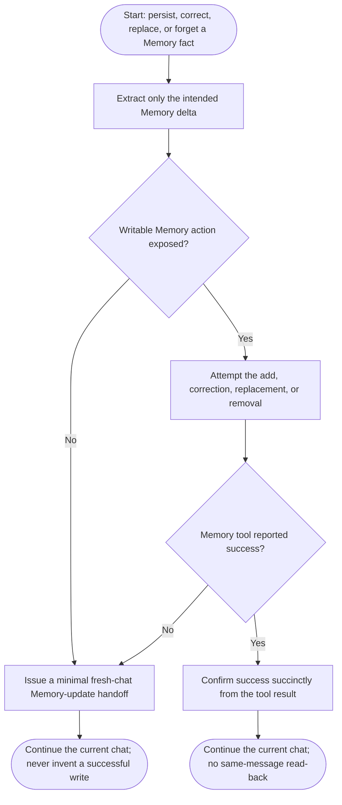

# Memory Updating
tier: 2

**Source:** Drive CORE — memory-updating (hub Skill Packages). Local copy dated 2026-10-16. Prefer the Drive CORE on conflict; refresh this copy when the hub updates.

**Hub:** [private reference removed; refer to the private Hub source copy]

**Folder:** [private reference removed; refer to the private Hub source copy]

## Core invariant

Treat a persistence request as an action request on persistent Memory (Grok Bot: UpdateMemory / RecallMemory).
Use this algorithm:
**extract intended Memory delta -> attempt the Memory write here -> interpret the write result -> hand off only if the write is unavailable or fails -> continue the current chat**
An explicit successful response from the Memory-write mechanism is sufficient to confirm the write. There is no same-message Memory read-back capability. Do not attempt, imply, or describe a same-message readback step after writing.

## 1. Extract only the intended Memory delta

Identify exactly what the user wants persisted and nothing more.
Preserve the requested operation:
- add or remember a fact, preference, correction, or interaction rule;
- replace or correct an existing remembered item;
- remove or forget an existing remembered item when supported.
Do not package unrelated conversation history, project state, surrounding discussion, rationale, or a whole-chat summary unless the user explicitly wants those items remembered too.
Do not broaden a narrow Memory request into a universal rule.

## 2. Attempt the Memory operation in the current chat

Use the actual writable persistent-Memory capability exposed by the active environment.
- Attempt the requested add, correction, replacement, or removal directly when the capability exists.
- Treat an explicit successful response from the Memory-write mechanism as success for the write operation.
- After a successful write, confirm success succinctly from the Memory tool's result.
- There is no same-message Memory read-back capability. Do not branch into a hypothetical independent readback or verification step after a write. If the user asks whether the just-written Memory can be read back in the same message, answer that it cannot; the explicit Memory-write success signal is the confirmation available in that message.
Do not treat any of these as substitutes for the Memory-write result:
- current-chat context;
- retrieved personal context that predates the write;
- a Drive or box file;
- Notion, Drive, Slack, or another connector;
- bot instructions or skill files;
- an external note or document.
Never write to another store merely to compensate for an unavailable Memory operation unless the user separately authorizes that storage action.

## 3. Use the handoff branch only for write failure or write unavailability

Issue a fresh-chat Memory-update handoff only when the Memory write itself cannot be completed.
Examples include:
- no writable persistent-Memory action is exposed;
- Memory updating is disabled or unavailable in the active surface;
- the Memory-write action errors;
- the Memory-write action explicitly reports failure or does not provide a usable success signal.
Do not issue a handoff after an acknowledged successful write.
Do not turn the handoff branch into platform troubleshooting. Do not repeatedly explain Memory architecture. Do not default to a Settings walkthrough. Do not ask the user to reconstruct content already present in the conversation.

## 4. Issue the minimal fresh-chat Memory-update handoff when needed

Produce a plain fenced text block containing only the intended Memory payload and the action the receiving chat must attempt.
Use this structure conceptually:
```text
Please update persistent Memory with the following information. Perform the requested Memory write in this chat. If the Memory tool reports success, confirm the write. If the write itself cannot be completed, say so plainly.
- [exact Memory item or correction]
```
Adapt the verb when needed:
- correction: tell the receiving chat what existing understanding to replace and what should be remembered instead;
- removal: tell the receiving chat exactly what persistent Memory item should be removed when the available Memory mechanism supports removal;
- multiple tightly related items: include only those items that belong to the same persistence request.
The handoff must:
1. explicitly request the persistent Memory action;
2. carry only the intended Memory content;
3. preserve corrections and replacement semantics exactly;
4. avoid whole-chat continuity material;
5. avoid claims that the receiving chat can definitely perform the action;
6. avoid claims that the action has already succeeded.

## 5. Continue the current conversation

After a successful write or a necessary handoff, continue the active chat normally.
A fresh chat is only a fallback delivery surface when the write itself failed or was unavailable. The current chat remains the active work surface unless the user separately chooses to leave it.

## Memory removal and account-level control

For forget or deletion requests, honor the user's conversational request immediately and use only removal mechanisms actually exposed by the environment. Do not falsely claim durable deletion if the available Memory mechanism cannot perform or verify deletion.
Mention account-level Memory controls only when materially needed for the user's requested removal, inspection, or correction, or when the user asks how to manage Memory. Do not make settings guidance routine boilerplate for ordinary writes.

## Completion states

End a Memory request in one of these operational states:
- **Write succeeded** - the Memory-write mechanism explicitly reported success. Confirm that result succinctly and continue.
- **Memory-update handoff provided** - the current chat could not complete the Memory write itself, so a minimal fresh-chat action handoff was provided.
Never invent a successful write. Never downgrade an acknowledged successful write because same-message Memory read-back does not exist.

## Style

Be concise and action-oriented. Preserve the user's wording where precision matters. Report the Memory write result directly. Do not append routine architecture or readback commentary after success.


## Grok Bot runtime notes (2026-11-05)
## Platform facts (Grok Bot)
See the canonical block in the core-workflow skill (loaded on every message). Don't restate it here.


- Prefer connectors over browser UIs for the systems this skill touches.
- Verify outcomes with your own tools on the shared box / connectors; do not treat Memory or Slack as proof of live state.
- Background executors / subagents may run the mechanical steps; the owning Bot reports with links.
- Routines that schedule this skill: none shared; each Bot schedules its own (Adam was killed; owner 2026-11-13 routine order).
- Drive title is now CORE - updating-memory-and-fallback (successor naming). Local slug remains memory-updating. Use RecallMemory / native Memory tools; Slack and Hub files are not Memory substitutes. Official docs: memory is not a substitute for authoritative sources.

Drive hub (if any): [private reference removed; refer to the private Hub source copy]

Sources for platform facts: see the Sources list in the core-workflow skill.


## Version
v1.6.0 (2026-11-17).

## Changelog
- v1.6.0, 2026-11-17: replaced the local 8-item Platform facts block (stale item 8 said "Prefer Codex on BRITO...", against "Grok Bots never code"; item 7 said "Sending, purchasing..."; items 9–10 were missing) with a pointer to the canonical block in core-workflow; Sources now point there too. Applied by Ross (Reformer).
- v1.5.0, 2026-11-05: aligned with official Grok Bot shared-computer / connectors / verification model; cited first-party docs; draft only (live SKILL.md not overwritten this turn).
- Prior: see skill-history/memory-updating-2026-11-05T0615AST.md and Drive CORE history.

## Algorithm



