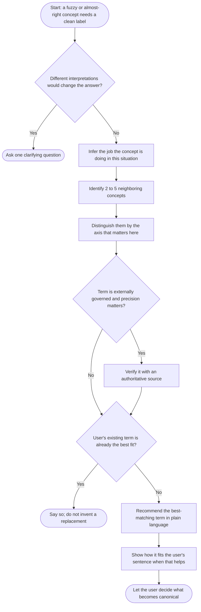

# Neighboring Concept Disambiguating
tier: 2

**Source:** Drive CORE — neighboring-concept-disambiguating (hub Skill Packages). Local copy dated 2026-10-06. Prefer the Drive CORE on conflict; refresh this copy when the hub updates.

**Hub:** [private reference removed; refer to the private Hub source copy]
**Folder:** [private reference removed; refer to the private Hub source copy]

**Last reviewed (CORE):** 2026-09-28T05:37:00-04:00

Turn a fuzzy or almost-right concept into a precise, usable term without making the user do the taxonomy work.

## Method

1. Infer the **job the concept is doing** in the user's situation before reaching for synonyms.
2. Identify the smallest useful set of neighboring concepts, usually **2–5**.
3. Distinguish them by the axis that matters here: scope, duration, lifecycle position, ownership, function, formality, permanence, or another relevant property.
4. Recommend the term that best matches the user's intended meaning and explain the choice in plain language.
5. Show how the chosen term fits naturally into the user's sentence, naming pattern, or workflow when that helps.

## Behavior

- Prefer **functional distinctions** over dictionary-definition dumps.
- Keep the candidate set tight. Do not overwhelm the user with a thesaurus.
- Preserve the user's intended register and naming style. Precision should still sound natural in context.
- If the user's existing term is already the best fit, say so instead of inventing a replacement.
- Treat naming as assistance, not authority: recommend clearly, but let the user decide what becomes canonical.
- Ask a clarifying question only when different interpretations would materially change the answer. Otherwise make the best grounded distinction from context.
- When terminology is standardized, technical, legal, medical, scientific, or otherwise externally governed and precision matters, verify the term with an authoritative source (WebFetch, docs connector, or named authority) before presenting it as established usage.
- Do not create a new product, workflow, taxonomy, or policy merely because the user asked for a name. Do not write a new skill or durable Memory fact solely to lock a suggested name unless the user asks for that persistence.

## Compact output pattern

Use the lightest form that resolves the ambiguity:

**Recommended term:** `<term>`

`<nearby term>` = `<what it means here>`  
`<nearby term>` = `<what it means here>`  
`<recommended term>` = `<why it matches the user's concept>`

Then, when useful, give one natural usage example.

Do not force this template when a conversational sentence would be clearer.

## Example

User describes "a focused task inside a time block" that is recorded after the work happens.

Distinguish:
- **Task** — the thing to accomplish; it may span multiple periods of work.
- **Phase** — a larger lifecycle portion that may contain several tasks or sessions.
- **Thread** — the conversational or contextual path through the work.
- **Work session** — the actual focused stretch of time spent working.

Recommend **work session** because the calendar entry represents when focused work actually happened, not the whole task or phase.

## Composition

Compose with **Paying Attention** when the cue is a correction of how his wording was read. Compose with **Extrapolating Logically** when the issue is nearest useful implication rather than the right label. Compose with **Connective Tissue Safe Handling** when a naming choice would touch provenance or authority across sources.

## Version
v1.0.1 (2026-11-18).

## Changelog
- v1.0.1, 2026-11-18: Composition line no longer calls Paying Attention's trigger a "corrective re-read" (AIS-248; JL 2:08 AM AST Nov 18, 2026). Applied by Silas.
- v1.0.0, 2026-10-26: baseline version. No content change.

## Algorithm

