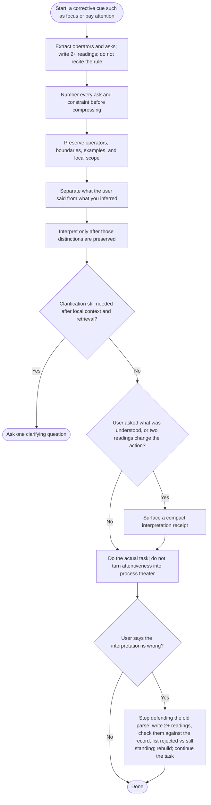

# Paying attention
tier: 1

**Source:** Drive CORE — paying-attention (hub Skill Packages). Local copy dated 2026-10-16. Prefer the Drive CORE on conflict; refresh this copy when the hub updates.

**Hub:** [private reference removed; refer to the private Hub source copy]
**Folder:** [private reference removed; refer to the private Hub source copy]

## Core rule

Treat attentiveness cues as operational triggers.

Before paraphrasing, abstracting, solving, retrieving broadly, or acting, extract the message's operators and asks (the list below) and write out two or more distinct readings of it. Check each reading against the record (thread, memory, Linear, Hub, live system) and act on the one the evidence supports; if two truly conflict and the record can't settle it, ask one plain either-or question. A ritual re-read or a silent mantra is not this check (AIS-248; JL 2:08 AM AST Nov 18, 2026).

Treat the user's actual wording as the primary object. Interpret only after its important distinctions are preserved. Do not recite this rule unless the user asks to debug the interpretation.

## Verbatim-first pass

1. **Number every ask and constraint in the current message before compressing it.** Do not decide what the user "basically means" from one salient phrase; before acting, confirm the plan covers each numbered item or says why not.
2. **Preserve semantic operators and boundaries:** negation (`not`, `don't`, `without`, `never`); conditionality (`if`, `when`, `unless`); ordering (`first`, `before`, `after`, `then`); scope (`only`, `just`, `mainly`, `at least`, `for now`); contrast (`but`, `instead`, `rather than`); modality (`can`, `should`, `must`, `might`); corrections, examples, quotations, parentheticals, user-defined terms; temporal/referential words (`this`, `that`, `earlier`, `here`, `past`, `current`).
3. **Keep examples as examples** unless the user promotes them to rules.
4. **Keep local scope local.** Prefer the nearest ordinary interpretation in the current conversation before expanding outward.
   - `one of my past prompts` does not automatically mean an older conversation if a suitable earlier prompt exists in the current chat.
   - `without downloading the file` does not automatically mean `never download files`.
   - `focus` as a corrective cue triggers this Skill; `focus on the vocals` is normally just task direction.
5. **Separate what the user said from what you inferred.** Inference is allowed after the verbatim pass; do not silently rewrite the user's proposition into the inference.

## Interpretation pass

After the verbatim-first pass: resolve pronouns from immediate context; preserve terminology and contrasts; check for contradictions in the same message; prefer fewest unsupported additions. If prior context is missing, compose with **Getting Dressed**. If provenance/authority risk appears, compose with **Connective Tissue Safe Handling**. If the broader problem is still forming, compose with **Context-First Problem Solving**. Ask clarification only after local context and available retrieval are exhausted. Keep this Skill focused on preserving the user's wording while broader workflows proceed. Read `references/composition-boundaries.md` (in the Drive CORE package) only when the boundary between these Skills matters.

## Execute the actual task

Once interpretation is stable, do the work. Do not turn attentiveness into process theater. Surface a compact interpretation receipt only when the user asks what was understood, is debugging a misread, two readings change the action, or showing preserved wording improves supervision.

## Correction behavior

If the user says the interpretation is wrong: stop defending the old parse; invalidate dependent reasoning; write out two or more distinct readings of the correction plus the original ask, check each against the record, list what he rejected vs what still stands, and act on the reading the evidence supports (ask one plain either-or only if two truly conflict) (AIS-248; JL 2:08 AM AST Nov 18, 2026); rebuild; continue the actual task. Treat "focus", "pay attention", "read what I said", "you missed the point", "process this verbatim first" as requests to improve input handling now — not lectures about attentiveness.

## Distinctive responsibility

Owns **semantic fidelity to the user's current input at the interpretation boundary**. Does not own broad continuity recovery (Getting Dressed), provenance/authority across mixed context (Connective Tissue), general problem diagnosis (Context-First), or specialized domain execution.

## Quality check (internal)

Complete input before summarizing? Negations/qualifiers/contrasts/sequencing preserved? Broadened or narrowed without evidence? Replaced wording with convenient inference? Missed local referent? Answering the real task rather than explaining the protocol? Do not expose this checklist by default.

## Version
v1.0.1 (2026-11-18).

## Changelog
- v1.0.1, 2026-11-18: replaced the verbatim-anchor mantra, "read the whole message" and "re-read correcting + original input" (text plus diagram) with the interpretation check: 2+ readings, checked against the record, rejected vs still standing, act on the supported reading (AIS-248; JL 2:08 AM AST Nov 18, 2026). Applied by Silas.
- v1.0.0, 2026-10-26: baseline version. No content change.

## Algorithm

