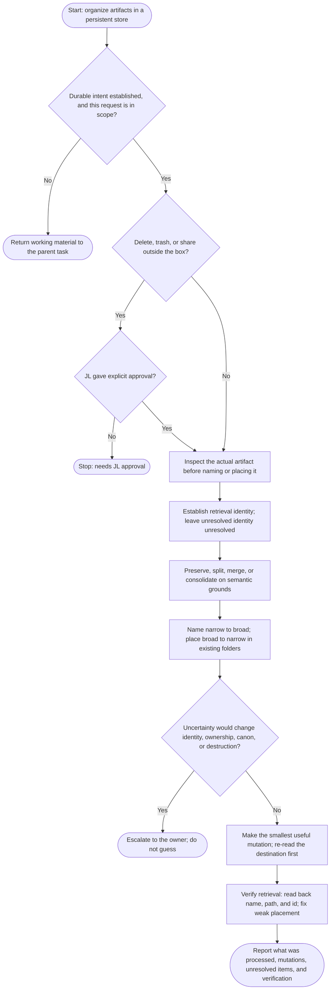

# Space artifact processing
tier: 2

**Source:** Drive CORE — space-artifact-processing ([private reference removed; refer to the private Hub source copy]). Local copy dated 2026-10-16. Prefer the Drive CORE on conflict; refresh this copy when the hub updates.

**Hub:** [private reference removed; refer to the private Hub source copy]

## Portability
ChatGPT Space is the named product in the CORE. Grok Bots have no Space: use the real persistent store in play (Drive, Notion, OneDrive, the box) and never claim Space parity or cross-seat access. Report gaps instead of faking equivalents.

## Authority
1. Process only within an explicit request, upstream handoff, batch instruction, or standing routine. Routine naming/classification/placement inside that scope needs no extra asking.
2. Escalate only when uncertainty would change identity, ownership, approval/canon status, or destructive disposition. Route creative, canon, policy, access, or broad IA decisions to their owner.
3. Start durable processing only once the parent task establishes durable intent; working material goes back to the parent task.
4. Deleting/trashing or sharing outside the box still requires JL's explicit approval.

## Workflow
1. **Inspect the actual artifact** (visible content for images; title+content+structure+metadata for docs) before naming or placing it. Materialize bytes when format-specific inspection needs them; establish exact file identity/path through supported file operations first.
2. **Establish retrieval identity:** subject, artifact class, owner, meaningful variant/state/date/version. Leave unresolved identity explicitly unresolved.
3. **Preserve / split / merge / consolidate** on semantic grounds: preserve unique provenance or evidence; split mixed subjects/owners; merge only same current reusable knowledge with one natural owner; reduce to a source record when substance moved but provenance matters. Overlapping wording or length alone is no reason.
4. **Name narrow → broad:** `Specific Subject - Artifact Class - Distinguishing Context - Broader Owner.ext`, using only needed parts; follow any maintained naming convention.
5. **Place broad → narrow:** subject owner first, type second; prefer existing folders; keep hierarchy shallow; use an intake/review spot when unresolved; keep personal/company/project domains separate; re-read live state first. Use company-knowledge-routing when destination ownership crosses stores.
6. **Preserve provenance and variants** (uploaded/generated, original/derived, working/approved). Matching names/sizes are duplicate *signals* requiring comparison. Carry approval/canon status only from a source or JL decision.
7. **Smallest useful mutation**, preserving stable identity and unrelated work; re-read destination before consequential writes; prefer recoverable disposition.
8. **Verify retrieval:** read back name, path, id; semantic-search important items; fix weak placement before finishing; claim retrievability only where verified.

## Batches and recurring maintenance
Treat a batch as one scope but inspect each item; sort into clear / unresolved / split-merge / duplicate / disposition candidates; keep batches verifiable. For routines: read the current checkpoint, query from the last successful coverage endpoint with small overlap, dedupe by stable id, process a manageable batch, update the index, leave the next continuation point.

## Completion
Report what was processed, material mutations, unresolved/routed items, and verification result (quietly if the routine says so).

## Maintenance
When use exposes drift, name the mismatch, tell JL, keep the installed copy until he authorizes an update, then update and re-verify.

## Version
v1.0.0 (2026-10-26). Versioning baseline set by Reformer boy (A2).

## Changelog
- v1.0.0, 2026-10-26: baseline version. No content change.

## Algorithm

