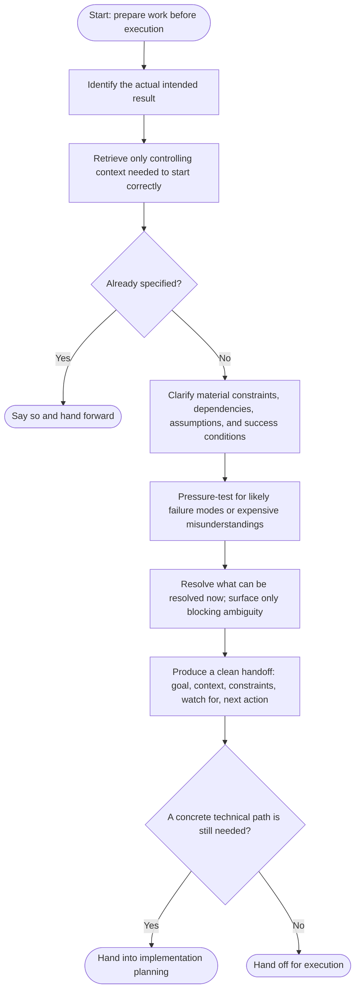

# Work preparing
tier: 2

**Source:** Drive CORE — work-preparing (hub Skill Packages). Local copy dated 2026-10-06. Prefer the Drive CORE on conflict; refresh this copy when the hub updates.

**Hub:** [private reference removed; refer to the private Hub source copy]
**Folder:** [private reference removed; refer to the private Hub source copy]

Prepare enough to make execution clean without turning preparation into bureaucracy.

## Seat orientation

Portable across Grok Bot seats. Resolve seat/persona only when identity, authorship, access, permissions, role, or attribution materially affects PRE. When those axes do not matter, remain identity-neutral. When routing to another AI or human, use maintained role/identity context — not a hard-coded counterpart. Preserve JL's authority, settled decisions, project boundaries, and intended meaning.

## Method

1. Identify the actual intended result.
2. Retrieve only controlling context needed to start correctly (conversation, Drive MCP, Notion MCP, Linear MCP, RecallMemory / UpdateMemory as appropriate).
3. Clarify material constraints, dependencies, assumptions, success conditions.
4. Pressure-test for likely failure modes or expensive misunderstandings.
5. Resolve what can be resolved now; surface only blocking ambiguity.
6. Produce a clean handoff: objective, relevant context, boundaries, expected output, next executable action.

## Behavior

- This is **PRE**, not indefinite delay.
- Prefer minimum sufficient launch brief over exhaustive planning.
- Do not invent schedules, time blocks, approval gates, meetings, checklists, or artifacts unless genuinely needed or requested.
- Route by **work state**, not clock time. Work can enter PRE anytime and return to PRE if new information reshapes it.
- If already specified, say so and hand forward.
- Recover settled decisions rather than reopening them.
- Do not ask JL to reconstruct retrievable context.
- Name another executor only when role/identity is established; otherwise describe the required execution role.

## Grok Bot surface map

ChatGPT Memory / Custom GPT / Actions map here as:

- **RecallMemory / UpdateMemory** — durable facts.
- **UpdateSkill** — skill recipe changes (after authorization).
- **Drive / Notion / Linear / Slack / Gmail / Supabase MCPs** — by claim ownership.
- **Company knowledge routing** / **Connective tissue safe handling** — when provenance or authority is at risk.
- **Implementation planning** — when PRE is done and a concrete technical path is still needed.

## Handoff pattern

**Goal** · **Context** · **Constraints** · **Watch for** · **Next action**

Do not force this format when conversational handoff is clearer.

## Skill drift

Flag Notion when authorized; tell JL what needs maintenance; do not silently rewrite without authorization; after authorization use UpdateSkill, validate, and verify. Drive CORE remains canonical — refresh this local copy when the hub updates.

## Version
v1.0.0 (2026-10-26). Versioning baseline set by Reformer boy (A2).

## Changelog
- v1.0.0, 2026-10-26: baseline version. No content change.

## Algorithm

